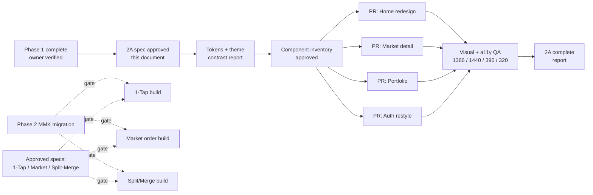

# Khant Hman — Phase 2A UI/UX Design Specification

> **Status:** DRAFT FOR PRODUCT-OWNER REVIEW — not approved, not implemented.
> **Audience:** Product owner (review/approval), then implementation engineers.
> **Scope of this document:** design and UX only. No application code, schema, seed, API, financial logic, build or deployment is authorized or performed by this file.
> **Current phase reminder:** Phase 1 (working local web application) is **not** complete; Phase 2A implementation must not begin until its roadmap gates are satisfied (§16).
> **Roadmap references:** `docs/PROJECT-ROADMAP.md`, Phase 2A (§2A.1–2A.6), Section 3 (engineering/financial rules), Phase 5 (blocked).
> **Baseline inspected:** `main` @ `9bc17ead4bfb08457b096fe56d4c205264c09aeb` (2026-11-16).

---

## 1. Purpose and scope

This document specifies how the Khant Hman user-facing web application should look and behave after the Phase 2A redesign. It is the design contract that future implementation tickets and PRs will reference. It covers:

- Evidence-classified audit of the current application (§3).
- Page-by-page UX requirements for homepage, discovery/listing, market detail, trading interface, portfolio, and login/signup/account (§6).
- Shared component specifications (§7) and a design-token system with Light and Dark themes (§8).
- Presentation of the four trading features (**1-Tap**, **Market**, **Limit**, **Split / Merge**) with the approved boundaries preserved (§9).
- Desktop and mobile layout proposals (§10) — labelled proposals; they have **not** been tested on devices.
- English/Burmese localization requirements (§11), accessibility (§12), preservation list (§13), proposed/future items (§14), an **Owner Decision Register** (§15), dependencies/gates (§16), acceptance checklist (§17), non-goals (§18).

Out of scope: implementing anything; the MMK-only migration; Staff/Admin tooling (Phase 3); PWA/Telegram (Phase 4); real-money anything (Phase 5, blocked); inventing financial rules.

## 2. Sources and evidence classification

### 2.1 Precedence (highest wins)

1. Explicit product-owner decisions (recorded decisions, owner review approvals).
2. `docs/PROJECT-ROADMAP.md` (Phase 2A sections and Section 3).
3. Existing Khant Hman implementation and verified behavior (this document cites exact files).
4. Polymarket observations and official first-party docs (`help.polymarket.com`, `docs.polymarket.com`) gathered 2026-11-15/16.
5. Design recommendations in this document (clearly marked PROPOSED).

Polymarket is a usability reference, **not** a specification. Nothing observed there overrides the rows above. No Polymarket branding, logos, assets or code are to be reused.

### 2.2 Evidence labels used in this document

| Label | Meaning |
|---|---|
| **CONFIRMED** | Approved by the product owner; binding for this design. |
| **EXISTING** | Implemented and verified in the repository at the stated baseline. |
| **PROPOSED** | Design recommendation awaiting owner approval; not binding yet. |
| **OPEN DECISION** | Only the product owner may decide; blocks specified work (see §15). |
| **BLOCKED** | Cannot proceed until a stated dependency/approval completes. |

### 2.3 Source inventory

| Source | Reference |
|---|---|
| Product roadmap | `docs/PROJECT-ROADMAP.md` — Phase 2A, §3 engineering rules, Phase 5 |
| Financial spec | `docs/FINANCIAL-SPEC.md` (legacy Pya units; MMK migration separate) |
| Technical roadmap | `docs/ROADMAP.md` (matching engine deliberately not started) |
| Resolution design | `docs/RESOLUTION-DESIGN.md` (resolution payout unimplemented) |
| Current UI pages | `app/[locale]/page.tsx`, `app/[locale]/{login,signup,portfolio}/page.tsx`, `app/[locale]/market/[slug]/page.tsx`, `app/[locale]/how-it-works/page.tsx`, `app/layout.tsx`, `app/page.tsx` (`/` → 307 `/my`), `app/globals.css` (2415 lines) |
| Current components | `src/components/{HomeView,MarketCard,MarketView,OrderTicket,OrderBook,PortfolioView,SiteHeader,AuthView,AppProvider}.tsx` |
| Formatting/i18n | `src/components/ui/format.ts`, `src/i18n/dictionary.ts`, `src/lib/locale.ts` |
| Data client types | `src/lib/api-client.ts` — `MarketSummary`, `MarketDetail`, `OrderView`, `Portfolio` (see §3.8) |
| Server trading | `src/domain/trading.ts`, `src/domain/reservations.ts`, `src/lib/money.ts` (legacy Pya) |
| Polymarket audit | Reference Audit report (2026-11-15); official help/docs articles cited inline where used |

### 2.4 What could NOT be verified (honesty register)

- No live screenshots exist for this audit (no browser tool). All layouts here are **proposals**, not measurements, and are **not** Polymarket screenshots either.
- Polymarket's trade-ticket modal, portfolio internals, theme toggle existence, and mobile layout were **not** directly observable (authentication-walled or not server-rendered) and are never cited as fact below.
- Mobile layout behaviour of *Khant Hman* itself was not device-tested for this spec.
- Proposed WCAG conformance of proposed token values must be verified with actual tooling during implementation.

## 3. Current application audit

Baseline file paths are cited for traceability. “Exists” reflects source-code inspection, not just what renders on first paint.

### 3.1 Homepage and market discovery — `/my`, `/en`

| Aspect | State |
|---|---|
| Exists | SSR `initialMarkets` via `listMarkets` (`app/[locale]/page.tsx`); featured carousel (`featuredIndex`, dots/arrows); “Hot topics” category panel; sort `select` (`closing`/`newest`/`activity`); category chips (`myanmar/economy/crypto/world/sports/technology`); results count; `MarketCard` grid; skeleton loading; empty state; error state + `Retry`; watchlist via `localStorage` (device-local); `virtual-ribbon` disclosure; Burmese/English strings in dictionary |
| Missing | 24h change, daily volume, liquidity depth, price history/chart data; per-category feed routes; account-synced watchlist; theme switching |
| Visually redesign | Warm paper background + radial gradients (not flat white); floating cards, heavy shadows/gradients; Georgia-serif italic flourishes; oversized hero; two-track visual identity vs confirmation surfaces |
| Preserve unchanged | `virtual-ribbon` disclosure placement; SSR initial catalogue (no empty flash); server-authoritative call path (`HomeView → /api/markets → listMarkets`); locale redirect `/ → /my`; localization parity |
| Later | Price/probability history chart; per-category feeds; watchlist sync |

### 3.2 Market listing, filters, search

| Aspect | State |
|---|---|
| Exists | Search (client `q=` param → `/api/markets?q=`), category chips, sort (`closing` default), `aria-pressed` chips, `market-results-meta` live region |
| Missing | Volume/liquidity (`MarketSummary` has **no** such fields), price-direction arrows, 24h movement; sort labels are misleading (`newest` shows "Status", `activity` shows "Open interest" — check `HomeView` mapping and relabel) |
| Redesign | Card density (grid → tighter rows); chips → compact segmented chips; card grid 2-col at desktop → 3-col ≥1280 PROPOSED; hover shadows → flat border transition |
| Preserve | Chip `aria-pressed`, live region announcements, debounced search (250 ms) |

**Reliably available metrics for cards** (from `MarketSummary`): YES bid, YES ask, implied probability (mid of book), open-interest shares, open orders, close time, status. **Not available:** volume, daily volume, liquidity depth, 24h change/price history, holders, trade count — do **not** invent or stub these with fake numbers (OPEN DECISION D-13).

### 3.3 Market detail page — `/my/market/[slug]`

| Aspect | State |
|---|---|
| Exists | Breadcrumb; question H1; status pill; stats strip (Yes probability, open interest, open orders); about; rules; resolution criteria; authoritative sources; YES & NO order books side by side (max 8 levels each, depth bars scaled to visible max); recent trades; aside `OrderTicket`; `initialMarket` SSR |
| Missing | Chart (no price-history collection exists); comments; resolved-market banner; current-value marked-to-market; outcome-row Buy buttons with explicit prices (prices shown only inside the ticket/cards) |
| Redesign | Long-form vertical flow is fine but spacing/typography is loud; stats strip spacing; book depth density; ticket vertical height; resolved state non-existent |
| Preserve | Server-authoritative flow, idempotent order calls (client uses `newIdempotencyKey()`), wallet sync after mutations, loading/empty/error/not-found states, sources with `rel="noopener noreferrer nofollow"` |
| Later | Chart (needs snapshot infra — OPEN DECISION D-05); comments (proposed deferral — D-04); activity/holders |

### 3.4 Limit order ticket and order book

| Aspect | State |
|---|---|
| Exists | BUY/SELL segmented control; YES/NO outcome buttons with live book prices; limit price input ± steppers + quick chips (`10/50/100/500`); quantity stepper (±10) + `10/50/100/500` quick chips; live collateral/payout/profit preview (`costOf`, `payoutOf`, `src/lib/money.ts`); insufficient-balance messaging; placement/cancel with idempotent replay; book depth rows (≤ 8); Pya prices 1–99 |
| Missing | Post-order confirmation surfacing is a thin `message` row (fine); no explicit “reserved” explainer; legacy Pya-only units (migration gate) |
| Redesign | Vertical height (place-order CTA folds far below 768 px); duplicated steppers; three separate vertical clusters (BUY/SELL + outcome + price + qty + summary) — merge into two-band compact layout (§9) |
| Preserve (**all behavior**) | Order placement/cancel, reservations, ledger, idempotency, price/quantity validation ranges (1–99 Pya), settlement paths — **unchanged in Phase 2A**; visual restyling only |

### 3.5 Portfolio — `/my/portfolio`

| Aspect | State |
|---|---|
| Exists | Summary strip: available / reserved / total credits + positions count; positions list (shares, cost basis, realized P&L, close date); open-order list (read shape); empty state; “not marked to market” honesty banners; virtual-credit ONLY disclosure |
| Missing | Position current value, unrealized P&L (requires mark source — D-06); **cancel button for open orders (currently cancel lives only on the market page ticket)**; trade/activity history (not implemented — future); reserved-vs-available explainer copy |
| Redesign | Summary cards look like heavy cards; table rhythm; positions list compactness |
| Preserve | “Not marked to market” honesty copy; realized-P&L sign colouring (keep text labels too); auth gate; disappearance of fake precision |

### 3.6 Login, registration, account

| Aspect | State |
|---|---|
| Exists | Shared `AuthView` (email + password; signup adds `displayName`); rate-limit + CSRF; secure sessions; signed-in redirect to `/portfolio`; per-account and per-client ceilings (see `src/lib/rate-limit.ts`) |
| Missing | Phone registration (open D-01); password reset; account settings page; email verification UX |
| Redesign | Heading scale, spacing tokens, consistent panel — lowest-priority page visually |
| Preserve | Server routes, rate limits, CSRF `route()` wrapper, session cookie flags — untouched |

### 3.7 English/Burmese translations

| Aspect | State |
|---|---|
| Exists | `dictionary.ts` (both locales, type-enforced shape); `getDictionary(locale)`; parity tests (`tests/unit/localization.test.ts`); Myanmar fontsource installed (`Noto Sans Myanmar` 400/500/600); HTML `lang` server-rendered; typography refinements CSS for `lang="my"` |
| Missing | Burmese strings for any future strings (must ship with every new key); currency format conventions not documented; some dictionaries duplicated meaning between `actions`/`market` namespaces (harmless) |

**Font gap EXISTING:** CSS references `"DM Sans"`/`Manrope` but only `@fontsource/noto-sans-myanmar` is installed; DM Sans/Manrope are **not** bundled and are **not** system fonts — the app silently falls back. §8.5 proposes fixing this (add fontsource packages or switch to system stack).

### 3.8 Data types (traceability for all page specs)

```
MarketSummary  = { id, slug, categoryId, categoryNameEn/My, questionEn/My,
                   status, closeAt, yesBidPya|null, yesAskPya|null,
                   impliedProbability|null, openInterestShares:int, openOrders:int }
MarketDetail   = MarketSummary + { descriptionEn/My, rulesEn/My,
                   resolutionCriteriaEn/My, sources[], book{yes,no}{bids,asks}, recentTrades[] }
OrderView      = { id, marketId, side, action, pricePya, remainingQuantity, … }   // see api-client
Portfolio      = { cash{availablePya, reservedPya, totalPya}, positions[{marketId, slug, side,
                   sharesHeld, costBasisPya, realisedPnlPya, questionEn/My, closeAt}] }
```

All amounts above are **legacy Pya integers** at the inspected baseline (MMK migration pending; see §16 gates).

## 4. Design principles

1. **Flat and quiet (CONFIRMED direction):** white light canvas, no texture, borders instead of shadows, one accent colour family, generous 8 px grid.
2. **Probability-first copy:** price in ¢/Pya + explicit percent (“မှန် probability 40%”); users read odds, not tickers.
3. **Uniformity beats cleverness:** one outcome-row component everywhere; one card everywhere.
4. **Compact density:** ≤ 12–16 px card padding, 8–12 px gaps; single scroll column on mobile.
5. **Honesty over flourish:** virtual-credit disclosure on every trading surface; “not marked to market”; no invented metrics; "Pya legacy" never presented as whole MMK.
6. **Bilingual parity is a requirement, not a pass:** every string ships in EN and MY in the same PR.
7. **Accessible by construction:** labelled controls, focus-visible rings, 44 px touch targets, no colour-only meaning, reduced-motion respect.
8. **Server-authoritative UI:** no client-side financial computation is trusted; preview is indicative, math mirrors `src/lib/money.ts` and is re-checked server-side.
9. **Progressive disclosure:** trading action first; rules/details one section below; advanced actions (cancel, split/merge) behind lightweight expanders.
10. **Phase discipline:** this spec adds no behavior; every gated feature renders inert ("Coming soon") until approved.

## 5. Page and component inventory

Components marked *restyle* keep their logic; *new* are additive; *remove* candidates need owner sign-off.

| Component | Existing | New | Pages that use it |
|---|---|---|---|
| `SiteHeader` (+ locale menu) | restyle | + theme toggle slot | all pages |
| `virtual-ribbon` | keep | — | all trading/portfolio/auth/home surfaces |
| `Footer` | restyle | — | all pages |
| `MarketCard` | restyle (flat, dense) | optional 3-col layout | Home, Search (later), Category (later) |
| `OutcomeRow` | — | new (shared; replaces ad-hoc Yes/No displays where practical) | Detail, Cards (compact variant) |
| `PriceProb` (price + % + track) | restyle | unified | Cards, Detail, Ticket |
| `StatusPill` | restyle | — | Detail, Cards |
| `OrderBook` | restyle (dense, 5 rows + expand) | — | Detail |
| `OrderTicket` | restyle (compact; behaviour frozen) | — | Detail |
| `TradeModeTabs` (1-Tap / Market / Limit) | — | new (1-Tap/Market inert) | Detail (inside panel) |
| `SplitMergePanel` | — | new static surface, inert | Detail (below book) |
| `PortfolioSummary` | restyle | — | Portfolio |
| `PositionRow` | restyle | — | Portfolio |
| `OpenOrderRow` | restyle | + cancel button (after owner approval; behaviour exists server-side) | Portfolio, Detail ticket |
| `AuthCard` | restyle | — | Login, Signup |
| `EmptyState` / `Skeleton` / `Toast` / `ConfirmDialog` | restyle | unify | all |
| `Disclosure` (virtual credits) | keep | unified component | all trading surfaces |
| `WatchToggle` | keep (PROPOSED sync later) | — | Cards |

Page inventory: Home `/[locale]`; Market detail `/[locale]/market/[slug]`; Portfolio; Login; Signup; How-it-works (secondary; inherits tokens). NOT in Phase 2A: admin, staff, analytics, settings account page (later).

## 6. Page-by-page UX specifications

Layouts below are **proposals requiring implementation verification**; no device testing has been performed. Desktop reference widths: 1366×768 and 1440×900. Mobile reference: 390×844 and down to 320 px. Wireframes are structural, not pixel-perfect.

### 6.A Homepage (`/[locale]`)

**Information architecture**

```
┌─────────────────────────────────────────────────────────────┐
│ virtual-ribbon (virtual-credit notice)                      │
│ Header: brand | search | nav | theme+lang | auth-actions    │
├─────────────────────────────────────────────────────────────┤
│ Hero band (compact): product promise + virtual CTA          │
├─────────────────────────────────────────────────────────────┤
│ Market snapshot strip (3 featured/highest-OI markets)       │
├───────────────────┬─────────────────────────────────────────┤
│ Category panel    │ Feed controls: chips · sort select      │
│ (vertical list,   ├─────────────────────────────────────────┤
│  count badges)    │ Market cards grid (dense, 3-col ≥1280)  │
│                   │ Loading skeletons / empty / error+retry │
├───────────────────┴─────────────────────────────────────────┤
│ Footer (disclosure, links)                                  │
└─────────────────────────────────────────────────────────────┘
```

**Requirements**

| ID | Requirement | Status |
|---|---|---|
| A-01 | Header keeps: brand lockup, centred search (≥640 px), nav links (Explore→`/`, Portfolio when signed in, How you win), locale switcher, auth actions (Sign in / Sign up or balance pill + logout). Add **theme toggle** (Light/Dark) to primary nav, right of locale switcher (placement is roadmap-fixed: “discoverable from the primary navigation”, 2A.1). Toggle must have `aria-pressed`/`aria-label` bilingual; persistence required by 2A.5 (mechanism = D-08). | CONFIRMED requirement (roadmap) + PROPOSED details |
| A-02 | Mobile header (≤820 px): brand + search icon + theme toggle + locale + hamburger. Search collapses into an expandable bar (not a hidden unrecoverable feature). | PROPOSED |
| A-03 | Hero must be compact (≤ 240 px desktop incl. sub-line); single sentence promise + one primary CTA (“Browse markets”) and one secondary (“How it works”). No giant illustration; existing hot-topics carousel may **not** be a permanent fixture — keep only if it degrades to ≤ 200 px. | PROPOSED |
| A-04 | Featured strip shows up to 3 highest-open-interest open markets (reuse existing data) with question, YES probability, close time. Clearly labelled as featured, deterministic, no manual curation. | PROPOSED |
| A-05 | Category panel lists categories with counts; selecting a chip filters feed. Keep existing chip behaviour (`aria-pressed`), move panel to a horizontally-scrollable chip rail on <1100 px. | EXISTING behavior + PROPOSED presentation |
| A-06 | Sort control: rename labels to honest ones — **“Closing soon” (`closing` → `close_at ASC`), “Newest” (`newest` → `created_at DESC`), “Most open interest” (`activity` → `open_interest DESC`)**; the sort option↔server mapping is EXISTING and stays identical. (Currently `newest` is labelled with the `status` string and `activity` with the `openInterest` string — relabeling only, no behavior change.) | PROPOSED relabel (logic EXISTING) |
| A-07 | Market card content (dense): category tag (small caps), question (2-line clamp, bilingual), price line: `Yes {p}%` + thin probability bar, NO price implied, footer row: `Open interest {n}` · `OI stake mmk?` (omit) · `Closes {relative}` + watch-toggle. **No volume/24h/liquidity numbers — data does not exist.** | PROPOSED |
| A-08 | Empty results: illustration-free flat empty state with headline + secondary action ("Clear filters"). Error: message + Retry (existing endpoints). Loading: 6 skeleton cards matching card metrics. | EXISTING states, restyle |
| A-09 | Watchlist remains device-local localStorage (`khanthman-watchlist-v1`); PROPOSED: optionally account-synced later — not Phase 2A. | EXISTING / PROPOSED(later) |
| A-10 | No autoplay animation faster than user control; honor `prefers-reduced-motion`. | PROPOSED |
| A-11 | Homepage must never render login/wallet/on-chain claims; virtual-credit ribbon persists. | CONFIRMED (product rules) |

**Card structure (dense)**

```
┌──────────────────────────────────┐
│ MYANMAR · CRYPTO        [tag]    │  small caps, muted
│ Will X happen by …?        [★]   │  2-line clamp question
│ Yes 42%  ▓▓▓▓▓▓░░░░░░            │  price+track
│ OI 1,240 shares · Closes 3d      │  muted meta row
└──────────────────────────────────┘
```

### 6.B Discovery / listing

Phase 2A keeps a **single unified listing surface** (Home feed). Dedicated search page, per-category routes, and “trending” are **later**, not Phase 2A (avoid scope creep).

| ID | Requirement | Status |
|---|---|---|
| B-01 | Filters composable: category chip ∧ search query ∧ sort. Changing any control re-queries `/api/markets` with same params as current implementation. | EXISTING |
| B-02 | Result count announced via `aria-live="polite"` (keep existing live region). | EXISTING |
| B-03 | Status filter (All / Open / Closing week / Resolved) — only listed filters backed by server query params may ship; the current API supports `status`; “Closing week” requires query support — mark MISSING-DATA/ENG, else omit in 2A. | OPEN DECISION D-14 |
| B-04 | On mobile, chips rail horizontally scrollable with snap; sort collapses into 44 px select. | PROPOSED |
| B-05 | Empty state offers reset (“Show all markets”). Error keeps Retry. | EXISTING pattern |
| B-06 | Pagination: keep fetch-all (current catalogue is small); if server caps response, add “Load more” button (not infinite scroll) — implementation decision after API audit. | PROPOSED |

### 6.C Market detail (`/[locale]/market/[slug]`)

**Required content (all reusable across categories):** title, category, status pill, YES/NO outcome rows with price+probability, chart slot, info/description, rules, resolution criteria, sources, order book, order/trade panel, closing info. Comments only to the extent supported + approved (D-04). **No per-category variants.**

**Recommended section hierarchy** — compare the two candidate orders and their trade-offs:

| Candidate | Order (top→bottom) | Pros | Cons |
|---|---|---|---|
| H1 | Outcomes + trading panel → About → Rules/Criteria → Sources → Order book → Recent trades | Trading-first; matches current app & matches Polymarket; single scroll | Book below fold on 768 px laptops |
| H2 | Outcomes (compact, read-only) → chart → About → Rules → trading panel → book | Chart gets early prominence | Splits the actionable cluster; duplicates probability display; mobile push-down of CTA |

**Recommendation: H1** (outcomes and trading controls remain above the fold and adjacent; rules immediately below, before deeper sections) — **but with the trading panel made sticky on desktop** (§9, §10). Outcomes/trading must never fall below long-form text. Status: PROPOSED (owner approval of hierarchy; no evidence contradicts it).

**Requirements**

| ID | Requirement | Status |
|---|---|---|
| C-01 | Breadcrumb (Home / category / question) retained. | EXISTING |
| C-02 | H1 question (bilingual), category tag, `StatusPill` (Open / Closed / Resolved / Paused). Status text must not misuse “Buy/Closes” semantics — fix the pill to show the market state (`open`/`closed`/`resolved`), not actions. | PROPOSED (copy fix) |
| C-03 | **Outcome rows**: one shared `OutcomeRow` per outcome — name (Yes/No), probability %, implied price (legacy display per current data), and a primary button (“Buy Yes” / “Buy No”) that sets the ticket outcome and focuses it. Rows must be identical across cards/detail. | PROPOSED |
| C-04 | Chart area: price-probability history slot. **Not buildable in 2A** — no snapshot collection, no history endpoint. Reserve a labelled “Chart coming soon” slot **only if** owner approves placeholder UX; otherwise omit entirely. Do not fake a chart. | D-05 OPEN DECISION |
| C-05 | About/Description (bilingual), Rules, Resolution criteria, Sources (external links, `noopener noreferrer nofollow`) in this order, then order book. | EXISTING |
| C-06 | Order book: two columns (YES/NO), max 8 levels (EXISTING), scaled depth bars, “Empty” copy when side empty. Keep ≤ 8 with “Show more” expander PROPOSED. | EXISTING + PROPOSED |
| C-07 | Recent trades: side, price, qty, time (EXISTING). Add “Trade history is virtual-credit only” microcopy under the table. | PROPOSED |
| C-08 | Closing/resolution info line: “Closes {date, relative}” + “Resolves per rules above” link. Resolved markets: banner “This market has resolved ({outcome})” + disabled trading + payout note — but resolution payout is **not implemented** (RESOLUTION-DESIGN) → banner copy must not promise payout timing until approved. | BLOCKED copy (D-07) |
| C-09 | Comments: **not implemented**; do not add in Phase 2A. Defer to later-MVP/future phase pending owner decision + moderation plan (D-04). Current page has none. | OPEN DECISION D-04 |
| C-10 | Aside: `OrderTicket` (all behaviour EXISTING; visual redesign only). Sticky on ≥1280 px within the two-column grid. | PROPOSED |
| C-11 | Mobile: single column — breadcrumb → H1/category/status → outcome rows (prices + buttons) → compact ticket (collapsible sections) → About/Rules → book/trades. Primary action visible without scroll on 390×844 (target ≤ 420 px from top incl. header). | PROPOSED |
| C-12 | Long numbers (prices 1–99, shares) use `tabular-nums`. | PROPOSED |
| C-13 | Error and “market not found” states retained. | EXISTING |
| C-14 | Loading: skeleton for question/stats/ticket (EXISTING skeleton). | EXISTING |

**Structural wireframe (desktop, ≥1280 px)**

```
┌───────────────────────────────────────────────┬────────────────┐
│ breadcrumb                                    │ ┌────────────┐ │
│ CATEGORY TAG            [StatusPill]          │ │ Trade      │ │
│ Question …              (H1, 2 lines)         │ │ panel      │ │
│ Yes 58% ▓▓▓▓▓▓░░ · No 42%                     │ │ (sticky)   │ │
│ OI 1,240 · Open orders 12 · Closes in 3d      │ │            │ │
│ ┌ OutcomeRow YES 58¢ — Buy YES …─────────┐    │ │ mode tabs  │ │
│ └ OutcomeRow NO  42¢ — Buy NO  …─────────┘    │ │ ticket     │ │
│ About …       Rules …       Criteria …        │ │            │ │
│ Sources …                                    │ │            │ │
│ Order book (YES | NO)     Recent trades       │ └────────────┘ │
└───────────────────────────────────────────────┴────────────────┘
```

### 6.D Trading interface — presentation only

See §9 for the full four-feature spec. Key page-level rules:

| ID | Requirement | Status |
|---|---|---|
| T-01 | Single shared panel; tabs (1-Tap / Market / Limit) in fixed order. Limit active-by-default until others are approved+built. | PROPOSED |
| T-02 | Panel compact: BUY/SELL segmented + YES/NO outcome on one row; price then qty; summary 2×2; one primary CTA. No independent scrolling inside the panel. | PROPOSED |
| T-03 | Primary CTA must be visible without scrolling at 1366×768 (two screens tall of content allowed below). | PROPOSED |
| T-04 | 1-Tap presets: 1,000 / 5,000 / 10,000 MMK. **Inert until approved** (“Coming soon” tooltip, disabled, no network calls). | CONFIRMED presets; BLOCKED build |
| T-05 | Market: amount input (whole MMK), available-cash line, presets 500/1,000/5,000/10,000, “Estimated to win” + “Average price” preview, confirm before execution. **Inert until approved.** | CONFIRMED fields; BLOCKED build |
| T-06 | Limit: preserve existing behavior exactly; Pya limits remain legal but non-MMK-clean (legacy); visual regroup only. | CONFIRMED/EXISTING |
| T-07 | Split / Merge: all users; 1:1; integral shares; **not** on the order book; placement proposal in §9.4; disabled until approved. | CONFIRMED scope; D-10/D-11 OPEN |
| T-08 | Execution semantics for 1-Tap/Market are **undefined** — quote TTL, slippage, partial fills, duplicate protection, failure paths all OPEN (D-02, D-03). | BLOCKED |

### 6.E Portfolio (`/[locale]/portfolio`)

| ID | Requirement | Status |
|---|---|---|
| E-01 | Summary band: Available / Reserved / Total credits + positions count (EXISTING semantics in Pya now; MMK integer display after migration). | EXISTING |
| E-02 | Position rows: market question (link), side chip (YES/NO), shares held, cost basis, realized P&L (existing). **Current value / unrealized P&L only if a reliable mark price exists** — currently absent → omit; do not compute from ask. | BLOCKED on D-06 |
| E-03 | Open orders list (EXISTING read). **Add cancel affordance in this page** — requires owner approval (server cancel path exists; UI currently cancels only from market page ticket). | OPEN DECISION D-12 |
| E-04 | “Not marked to market” honesty notice retained verbatim in intent. | EXISTING |
| E-05 | **Trade history (completed) NOT implemented → future scope.** Do not add/placeholder in 2A. | CONFIRMED future |
| E-06 | **No public profiles, wallet addresses, or holder leaderboards anywhere in MVP.** | CONFIRMED boundary |
| E-07 | Empty portfolio: CTA “Browse markets”. Signed-out: gate + CTA to login/signup. | EXISTING |
| E-08 | Every surface keeps virtual-credit-only disclosure. | CONFIRMED |

### 6.F Login / registration / account

| ID | Requirement | Status |
|---|---|---|
| F-01 | Login and signup share `AuthView`; unify panel styling with design tokens (card, inputs, button). EXISTING behavior (email+password, displayName on signup). | EXISTING + restyle |
| F-02 | **Registration method (email / phone / both) is an owner decision — do not decide in design.** Spec provides one form layout per method variant; Phase 2A may only restyle what exists. | OPEN DECISION D-01 |
| F-03 | No real-money/KYC/payment fields ever; no crypto wallet connect. | CONFIRMED |
| F-04 | Add “Forgot password” only when the endpoint exists — currently absent → not in 2A. | PROPOSED later |
| F-05 | Session/auth errors copy unchanged pending owner copy review. | EXISTING |

## 7. Shared component specifications

Common rules for all: 8 px spacing grid; `border-radius: var(--radius)` (8 px) except chips (999 px); 1 px `var(--line)` borders; **no shadows** (flat) except focus rings; transitions ≤ 160 ms; `prefers-reduced-motion` respected; focus-visible 2 px accent ring offset 2 px; colour tokens only from §8 (never raw hex in components).

| Component | Purpose | Key specs | Pages |
|---|---|---|---|
| `SiteHeader` | Primary nav | Height 60 px desktop / 56 px mobile; brand mark 28 px; search `min(560px, 40vw)`; nav links 14 px medium; auth actions: balance pill (amount tabular) or Sign in/Sign up buttons; theme toggle slot (icon-only, 40 px); locale pill; ≤820 px: hamburger dropdown | all |
| `virtual-ribbon` | Credit disclosure | Full-width, 32 px, centered, `role="note"`, icon + single line; never dismissible | all trading/auth/home/portfolio |
| `MarketCard` | Catalogue unit | Padding 12–14 px; category tag 11 px small caps; question 14.5/1.35 clamp-2; YES row (price %+track); meta row (OI, closes) 12 px; entire card ↔ `/market/[slug]`; hover = border colour change only | Home |
| `OutcomeRow` | Buy Yes/No | 56 px row: label (Yes/No 15 medium), probability %, implied price, 48 px? button “Buy Yes/No”; states: default/hover/focus/active; disabled when market not open | Detail, (cards compact variant later) |
| `PriceProb` | Price+% display | Price large (17–20 semibold tabular) + `{v}%`; probability track 4 px, fill `var(--accent)`; NO row identical; used inline in card + detail + ticket | Cards, Detail |
| `StatusPill` | Market state | Pill 24 px, 12 px text, dot; variants open (green), closed (amber), resolved (neutral), paused (grey); always text+dot, not colour-only | Detail, Cards |
| `OrderBook` | Depth display | 2-col grid gap 12; header “Yes / No”; ≤8 rows; bid/ask columns tint `rgba` of accent at low alpha; depth bar `transform-origin:left` transition 160 ms; empty copy per side | Detail |
| `OrderTicket` | Trade entry | Container 320–360 px aside; surface `var(--surface)`; header “Place order” + mode tabs; body padding 14; summary 2×2 mini-grid; CTA full-width 48 px; max height none; sticky ≥1280 px; disabled state styling; message area `role="status"` | Detail |
| `TradeModeTabs` | Feature switch | Segmented control, 3 segments, 40 px; order fixed: 1-Tap, Market, Limit; 1-Tap/Market disabled with “Soon” badge; keyboard: roving tabindex, arrow keys | Detail |
| `SplitMergePanel` | Collateral↔shares | Static informational surface: description, two buttons “Split”/“Merge” disabled with tooltip “Available after approval”, integral share input mock; **no network calls, no ledger actions** | Detail |
| `PortfolioSummary` | Balance band | 3 stat tiles (Available/Reserved/Total) + positions count; values tabular 20 px semibold | Portfolio |
| `PositionRow` / `OpenOrderRow` | Portfolio rows | Grid: question (link) / side chip / shares / cost / realized P&L (realized only in 2A) / close date; orders: market, side, price, remaining, limit, age, (cancel after D-12 approval) | Portfolio |
| `AuthCard` | Auth panel | Single card ≤ 400 px, 24 px padding; inputs with labels (no placeholder-only); primary full-width button; error banner `role="alert"` | Login, Signup |
| `EmptyState` / `Skeleton` | Async states | Dashed-border? No — flat `var(--surface-2)` block with headline + body + CTA; skeleton shimmer via CSS gradient animation (reduced-motion: static) | all |
| `Toast` | Ephemeral feedback | Bottom-center mobile / bottom-right desktop; ≤ 4 s; `role="status"`; variants info/success/error | all |
| `ConfirmDialog` | Destructive confirm | Used for order cancel & (later) 1-Tap confirm; actions right-aligned; Esc/overlay close; focus trap | Detail/Portfolio |
| `WatchToggle` | Device watchlist | Star icon button 36 px; `aria-pressed`; device-local only | Cards |

**Component inventory matrix** — see §5 table (single source; kept in sync there).

**Dialogs:** confirm pattern = title + body + [Cancel][Confirm]; destructive confirms (cancel order) use explicit verb (“Cancel order”). **Toasts** never used for errors requiring action — use inline `role="alert"`.

## 8. Design tokens and theme system

### 8.1 Token architecture

Three layers; components consume **semantic** tokens only:

- **Primitives** (raw scales): colour ramps, spacing, radius, type, motion.
- **Semantic** (`--bg`, `--surface`, `--text`, `--muted`, `--accent`, `--line`, …): what components use; these flip per theme.
- **Component** (optional, only when a one-off is unavoidable): `--ticket-summary-bg` etc. Avoid.

Dark theme = same semantic names, remapped primitive values, activated via `:root[data-theme="dark"]` (or `prefers-color-scheme` + `data-theme` stamp set before paint to avoid FOUC). Roadmap 2A.1 fixes the requirement that a user-accessible Light/Dark switch in the **primary navigation** exists and that Dark Mode covers all listed surfaces consistently; roadmap 2A.5 acceptance requires the choice to persist. The owner decision still needed is the **persistence mechanism** (localStorage vs cookie vs account preference) and the no-flash strategy — **D-08**. **D-09** only sequences the work inside Phase 2A (same PRs vs immediate fast-follow); it cannot remove dark coverage from 2A without a roadmap edit, which this spec does not authorize.

### 8.2 Colour tokens (PROPOSED values — contrast must be verified with tooling before merge)

| Semantic | Light | Dark | Notes |
|---|---|---|---|
| `--bg` | `#ffffff` | `#0e1514` | flat canvas |
| `--surface` | `#ffffff` | `#131c1b` | panels on canvas |
| `--surface-2` | `#f6f7f6` | `#182220` | subtle fill (chips, inputs? no—inputs keep white) |
| `--surface-3` | `#eceeeb` | `#1f2a27` | hover fill |
| `--line` | `#e3e7e3` | `#25322f` | 1 px borders/separators |
| `--line-strong` | `#cdd4cd` | `#35443f` | focused/active borders |
| `--text` | `#101a19` | `#e9edeb` | primary ink |
| `--muted` | `#5c6f6b` | `#93a49f` | secondary text (≥4.5:1 on both canvases PROPOSED) |
| `--accent` | `#0e7767` | `#3dd598` | brand green; dark brightened for contrast |
| `--accent-hover` | `#095c51` | `#57d3a1` | |
| `--accent-soft` | `#e9f3ee` | `#16302a` | selected chip/outcome bg |
| `--on-accent` | `#ffffff` | `#05231a` | text on accent |
| `--up` | `#0e7767` | `#3dd598` | gains/yes/buy-positive |
| `--down` | `#b3261e` | `#ff8a80` | losses/no (text usage) |
| `--danger-surface` | `#fdecea` | `#2a1714` | error banner fill |
| `--warning-surface` | `#f6ecd4` | `#2a2413` | caution fill |
| `--warning-ink` | `#6b4e12` | `#e0c073` | caution text |
| `--focus-ring` | `#0e7767` 2 px + 2 px offset | `#3dd598` 2 px + 2 px offset | always visible |
| `--scrim` | `rgba(16,26,26,.45)` | `rgba(0,0,0,.6)` | dialogs |

**Rules**

- No other hues; no raw hex in component CSS.
- Depth = 1 px border + canvas contrast only. **No drop shadows anywhere** (dialogs may use scrim). (Matches CONFIRMED “avoid unnecessary card backgrounds/borders/shadows.”)
- Semantic colour is never the sole carrier of meaning (icons/text accompany).
- Yes/No colour semantics stay green/red but always paired with text labels.

### 8.3 Typography (PROPOSED)

| Token | Value |
|---|---|
| `--font-sans` | `"Inter", system-ui, -apple-system, "Segoe UI", Roboto, "Noto Sans Myanmar", sans-serif` — *implementation choice; adding the Inter fontsource package is a dependency decision* (owner sign-off required for any new dependency) or use system-ui only |
| `--font-myanmar` | `"Noto Sans Myanmar", "Noto Sans", system-ui, sans-serif` (EXISTING, keep) |
| `--font-serif` | Georgia — **dropped from product UI** in redesign (flat minimal direction); may remain for How-it-works only if owner keeps it |
| Mono/tabular | `ui-monospace, "SF Mono", Menlo, Consolas` + `font-variant-numeric: tabular-nums` for all prices/shares |

Scale (px / line-height): `12/1.4` caption · `13/1.5` meta · `14.5/1.55` body · `16/1.5` lead · `20/1.35` h4 · `24/1.25` h3 · `30/1.15` h2 · `40/1.08` h1 · hero `clamp(2.4rem, 6vw, 4rem)`. Myanmar type: optical sizes render slightly larger — keep html[lang="my"] overrides pattern EXISTING (do not delete without replacement).

### 8.4 Spacing, radius, borders, elevation

- Spacing scale: `2 4 8 12 16 20 24 32 40 56 72` px (8 px grid, 4 px half-steps).
- Radius: `--radius-sm 6`, `--radius 8`, `--radius-lg 12`, `--radius-pill 999`.
- Borders: `1px solid var(--line)`; strong = `--line-strong`. Dividers inside rows = `--line`.
- Elevation: none. Overlays/dialogs: scrim + 12 px radius. Focus: ring (§8.2), never shadow.
- Card paddings: 12 (dense) – 16 (panel). Row min-heights: 40 (tight) / 44 (touch default) / 56 (outcome rows).

### 8.5 Known font gap to fix in implementation (EXISTING bug)

CSS references `Manrope` (wordmark/headings), `DM Sans` (body), and Georgia (serif italics) but none of the first two is bundled (`package.json` has only `@fontsource/noto-sans-myanmar`; Georgia is a system font, so it silently survives on desktop and disappears on many Linux/mobile setups). The app therefore falls back to system stacks today. Fix = install chosen fontsource packages (owner-approved dependency) or switch the stack to system fonts. Decide in the tokens/theme PR with owner sign-off — no new dependency without approval.

### 8.6 Inputs and buttons

**Buttons — sizes:** `sm` 36 px h (icon/compact), `md` 44 px (default), `lg` 48 px (primary CTA / full-width ticket CTA). Min width 88 px; padding 0 16/20/24. **Variants:** `primary` (accent fill, on-accent ink), `secondary` (surface-2 fill, line border, text ink), `ghost` (transparent, hover surface-3), `danger` (transparent, danger ink; danger solid only for irreversible confirms), `quiet` (link-styled). States: default / hover (fill darken 1 step) / active (translateY(1px) for tactility? — flat: darken only) / focus-visible ring / `aria-busy` spinner (replace label with spinner+"…") / disabled (40% opacity + `not-allowed`). Icon buttons 40–44 px with `aria-label`.

**Inputs —** height 44; radius 8; 1 px `--line`, hover `--line-strong`, focus: `--accent` border + ring; label above input (12–13 px medium); help/error text below (12 px; error = down-colour + `role="alert"`); numeric inputs right-aligned tabular; selects styled natively with custom chevron bg (no library); segmented control = joined buttons with accent-soft selected state; steppers = 40 px square buttons each side of value.

### 8.7 Responsiveness breakpoints

`560` (small phone landscape) · `820` (tablet/large phone) · `1100` (desktop nav) · `1280` (3-col grid + sticky ticket) · `1440+` (max-width 1120–1200 container). Container: `width: min(1120px, 100% - 2*clamp(16px,3vw,32px))`. Never remove horizontal padding below 16 px.

### 8.8 Density

Card question clamp 2 lines; list row gap 8–12 px; section gap 24 (desktop) / 16 (mobile); page vertical rhythm 32–56. Density target: Home fits ≥ 6 cards above fold at 1440×900 (with featured strip removed or ≤160 px tall).

### 8.9 Contrast & verification requirement

All pairs must hit **WCAG 2.2 AA**: 4.5:1 body text, 3:1 large text/UI/borders-meaningful. Implementation PR must include a token-contrast report (script or manual tool). Any pair failing is fixed before merge — never by weakening the rule.

## 9. Trading-interface presentation (the four features)

**Global baseline facts (EXISTING):** all amounts are integer **Pya** at the inspected baseline; prices bounded 1–99; quantity integer shares; placement is idempotent (server replay-safe); wallet reserved at placement; settlement on match in server domain code. **None of this changes in Phase 2A.** MMK whole-unit display arrives with the separate Phase 2 migration (gate §16); this spec must not show half-MMK (kyat) anywhere once migrated, and the legacy Pya must never be labelled “MMK”.

### 9.0 Shared panel anatomy (all modes)

```
┌─────────────────────────────┐
│ 1-Tap | Market | Limit      │  segmented tabs (roving tabindex)
├─────────────────────────────┤
│ [Buy ▾]          [YES][NO]  │  side + outcome (ONE row)
│ (mode body differs — below) │
│ ┌ Summary ────────────────┐ │
│ │ Cost …   Payout …       │ │  totals, fees row NEVER (no fees)
│ │ Potential profit …      │ │
│ └─────────────────────────┘ │
│ [ Primary CTA (full width)] │
│ Virtual credits — not real  │  permanent microcopy
└─────────────────────────────┘
```

### 9.1 1-Tap (CONFIRMED feature, BLOCKED build)

**Approved boundaries (do not expand):** presets **1,000 / 5,000 / 10,000 MMK**; intended owner preference — the preset tap **executes immediately** after server-side validation and a valid execution quote; separate approved product/technical spec required for execution semantics, quote freshness, safeguards, duplicate submissions, accidental taps, failure behavior.

**UI (inert in 2A):** tab label “1-Tap” with badge “Soon”; body shows copy “Tap-to-buy with preset amounts. Coming soon.” and three disabled preset buttons (1,000 / 5,000 / 10,000 ကျပ်); disabled CTA. No requests fire. Keyboard focus allowed, `aria-disabled="true"`.

**Required before build (spec, not this document):** execution path definition; quote object + TTL; slippage/impact policy; partial-fill policy; idempotency beyond client key (server dedup window); double-tap/300 ms debounce; offline/timeout UX; insufficient-credits path; confirmation-vs-instant final ruling; audit logging. Owner decisions D-02, D-03, D-16. **This spec does not define them.**

### 9.2 Market (CONFIRMED feature, BLOCKED build)

**Approved boundaries:** BUY/SELL; **whole-MMK amount input** (no decimals); available-cash display (EXISTING wallet data); presets **500 / 1,000 / 5,000 / 10,000 MMK**; **Estimated To Win** and **Average Price** in the preview; **execution preview before final Buy/Sell confirmation**.

**UI (inert in 2A):** mode body shows: available line (“Available: {n} ကျပ်”), amount input with `inputmode="numeric"`, preset chips, preview rows (Estimated to win / Average price / Cost), disabled CTA “Review order”. No semantics implemented.

**Required before build:** matching/execution engine spec (walk the book vs auction vs crossing engine), partial fills, price impact, slippage tolerance default, quote computation & validity window, max-cost reservation rules, failure atomicity, rate limiting. Owner decisions D-03, D-16. **This spec does not define them.**

### 9.3 Limit (EXISTING — preserve behavior exactly)

- Behavior frozen: price 1–99 (Pya), integer shares, BUY/SELL, YES/NO, reservations, ledger, idempotency, settlement on match — **all untouched**, including Pya units.
- Visual redesign allowed: regroup into §9.0 anatomy (side+outcome one row; price and qty stacked with 44 px inputs; summary 2×2; single 48 px CTA “Place order”); move cancel into an “Open orders (n)” disclosure inside the panel on detail page (E-03 requires D-12 for portfolio page); keep insufficient-balance inline alert; keep message/`role=status` area.
- **Not whole-MMK compliant.** The migration to MMK integers will re-render these values with `formatMmk`; do not label Pya values “MMK”. Tracked dependency §16.
- Quick chips (10/50/100/500) stay but grouped with qty; proposal to retune chip sets under MMK spec, gated.

### 9.4 Split / Merge (CONFIRMED feature, BLOCKED build)

**Approved boundaries:** available to **all users** (never gate to “market makers”); **Split**: market-specific MMK collateral → **equal YES and NO shares, 1:1**; **Merge**: reverse; integral share counts (not currency); **not an order-book action** — a separate collateral/share conversion; accounting (collateral definition, debits/credits, share create/burn, atomicity, idempotency, ledger entries, validation, lifecycle restrictions) requires a separate approved specification.

**UI (inert in 2A — static placement only):** a secondary full-width panel **below the order book** (proposal D-10) headed “Split / Merge (coming soon)” with explainer line, two disabled buttons “Split”/“Merge”, and one disabled integral-share input; `aria-disabled`; zero network calls; excluded from tab order of the ticket. Alternative placement (inside ticket as 4th mode) is **rejected** in this proposal — split/merge is not an order, and putting it in the ticket invites conflation with order-book execution.

**Required before build:** collateral asset definition; per-market escrow/locking; create/burn journal rules; rounding (shares integral ⇒ collateral divisible by shares); atomicity & idempotency; failure recovery; UX for insufficient YES/NO balance on merge; disclosures; phase-gate verification. Owner decisions D-10, D-11. **This spec does not define accounting.**

### 9.5 Shared interaction states

| State | Spec |
|---|---|
| Signed-out | Panel renders same layout, CTA → “Sign in to trade” (link), no preset/amount entry, book remains visible |
| Insufficient credits | Inline banner (danger-surface) “Not enough virtual credits. Available: {n}.” + disabled CTA |
| Market closed/resolved | Panel disabled; CTA “Trading closed” / “Resolved”; join detail banner (C-08) |
| Submitting | CTA `aria-busy`, spinner + verb (“Placing…”), inputs disabled, no double submit (client key **and** server dedup) |
| Failure | Inline `role=alert` with short reason + Retry button; never auto-retry an order automatically |
| Success | Toast success + wallet refresh (EXISTING `refresh()`); clear inputs; keep outcome selection |

### 9.6 Mandatory disclosure line (all modes, all themes)

“These are virtual credits for practice. There is no real money, deposit, or withdrawal.” — bilingual key `notice.virtual`. Non-dismissible, present at every trading surface (CONFIRMED).

## 10. Desktop and mobile layouts

All entries below are **proposals requiring implementation verification** (no mobile device testing performed for this spec; no Polymarket mobile screenshots exist to copy). Reference: Desktop 1366×768, 1440×900; Mobile 390×844, minimum 320 px.

### 10.1 Global chrome

| Element | Desktop (≥1280) | Laptop (1100–1280) | Tablet (820–1100) | Mobile (<820) |
|---|---|---|---|---|
| Header | 60 px, all nav visible incl. theme toggle + locale + auth | same | condensed nav; search width shrinks | 56 px; hamburger reveals search, nav links, locale; theme toggle stays visible |
| Container | min(1120, 100%-48) | same | 100% − 32 px | 100% − 32 px |
| Footer | 3-column (brand · product · legal) | same | 2-column | stacked, single column |
| Virtual ribbon | inline, left-aligned within container | same | same | same, 11–12 px text, wraps allowed |

### 10.2 Home / discovery

| Aspect | Desktop | Mobile |
|---|---|---|
| Order | Hero(≤200 px) → featured strip → category rail + feed grid → footer | Hero → featured (horizontal snap-scroll, 86% card width) → chip rail (horizontal scroll) → cards single column → footer |
| Columns | ≥1280: 3-col card grid (22 px radius none, flat) | 1 column; ≥560: 2-col for cards |
| Category panel | Left rail (220 px, sticky) + feed right | Chips rail on top of feed (sticky under header optional) |
| Loading | 6 skeleton cards | 4 skeletons |
| Primary action visibility | “Browse markets” CTA in hero; search always visible | Same; search via expanded bar |
| Scroll behaviour | Normal; chips remain in-flow (no sticky) | Normal; no horizontal page scroll ever (rails only) |

### 10.3 Market detail

| Aspect | Desktop ≥1280 | 820–1280 | <820 (390×844) |
|---|---|---|---|
| Grid | 12-col: content 8 / ticket 4, ticket **sticky** (top 76 px) | content 7 / ticket 5, in-flow | single column |
| Order | Title/status → outcomes → About → Rules/Criteria → Sources → Book (2-col) → Trades | same | breadcrumb → H1 → status → **outcomes rows → ticket (compact, expanded by default; collapsible “Summary”)** → About → Rules → Sources → Book (tab YES/NO? proposal: keep 2-col but allow horizontal scroll of table) → Trades |
| Ticket | Right aside, full mode tabs | below content? No — beside, narrower | **above About**; CTA “Place order” visible without scrolling (target ≤ 430 px from top at 390×844 including header + ribbon) |
| Book visibility | both sides side-by-side | side-by-side | side-by-side at ≥390, else NO side stacks below YES with toggle |
| Dialogs | centered modal (max 420) | same | bottom sheet (full width, top radius 16), drag-to-dismiss |
| Scrolling | single page scroll; panel never independently scrolls | same | same |

### 10.4 Portfolio

| Aspect | Desktop | Mobile |
|---|---|---|
| Order | Summary band (4 tiles) → positions list → open orders (disclosure) | Summary 2×2 → positions list cards → open orders |
| Current value | Omitted until D-06 approved | same |
| Empty state | CTA “Browse markets” | same |

### 10.5 Auth (login/signup)

Centered card ≤ 400 px; on mobile full-width with 16 px gutters; logo above card; virtual ribbon; no side illustration.

### 10.6 Touch, keyboard, zoom

Touch targets ≥ 44 px (chips ≥ 40 with 4 px gaps); no hover-only affordances; 200 % zoom must reflow without loss (grids collapse to 1 col by 820 px); focus order follows visual order (ticket after outcome rows in DOM); skip link EXISTING kept.

## 11. English / Burmese localization requirements

| ID | Requirement | Status |
|---|---|---|
| L-01 | Every user-facing string lives in `src/i18n/dictionary.ts` in **both** `en` and `my`. No literal UI strings in components. New 2A keys ship in the same PR (parity tests must pass). | CONFIRMED process |
| L-02 | Parity test `tests/unit/localization.test.ts` extended for every new key (theme toggle, mode tabs, split/merge labels, statuses, errors). CI enforces shape equality. | EXISTING + extend |
| L-03 | Burmese glyphs: Noto Sans Myanmar (400/500/700) — Latin digits for prices/dates (propose `en` numerals in `my` UI; Burmese numerals optional later, owner decision). | PROPOSED |
| L-04 | Currency microcopy: `ကျပ်` suffix in Burmese contexts (e.g. “5,000 ကျပ်”); `MMK` prefix/suffix in English (“MMK 5,000”); whole MMK only — no decimals, no Pya labels once migrated (legacy copy must reference Pya explicitly as “Pya (legacy)” if shown at all). | CONFIRMED naming |
| L-05 | Product name **Khant Hman Prediction Market** / **ခန့်မှန်း ဈေးကွက်** everywhere (metadata, headers, legal/footer). | CONFIRMED |
| L-06 | Text expansion: budget +40 % width for Burmese; no fixed-width chip text; `min-width` on buttons but flexible. | PROPOSED |
| L-07 | Dates/relative time via `Intl.RelativeTimeFormat`/`DateTimeFormat` per locale; absolute date `medium` style; market close always shows absolute date + relative in tooltip/subline. | PROPOSED |
| L-08 | Direction: both LTR; no RTL needed. | CONFIRMED |
| L-09 | No hardcoded English plural logic; Burmese has no plural inflection — phrase to avoid counts where possible (“Orders (3)” ok). | PROPOSED |
| L-10 | Numbers: `Intl.NumberFormat(locale)`; `tabular-nums` mandatory for price/share columns. | PROPOSED |
| L-11 | Mixed-script strings (English terms inside Burmese UI, e.g. “order book”) keep Myanmar script adjacent spacing; glossary `docs/glossary.md` PROPOSED to freeze terms (Yes/No = ဟုတ်/မဟုတ်? — **do not pick translations here**; translation needs owner/native review). | OPEN (D-17 folded into implementation note) |
| L-12 | Virtual-credit disclosure string is fixed (`notice.virtual`) and never reworded per page. | EXISTING/CONFIRMED |

New-key starter list (illustrative, all must be translated): `theme.toggle.light/dark`, `trade.mode.oneTap/market/limit`, `splitMerge.title/split/merge/comingSoon`, `status.open/closed/resolved/paused`, `sort.closing/newest/activity`, `portfolio.reserved`, `ticket.previewToWin/averagePrice`, `notice.virtual`.

## 12. Accessibility and interaction states

Target: **WCAG 2.2 AA**. Baseline keeps existing skip-link, `lang` SSR, aria-pressed chips, live regions, `role=status/alert` patterns, focus-visible outlines — extend them.

| Domain | Requirement |
|---|---|
| Contrast | §8.9; verify token pairs with tooling; states (hover/disabled/focus) also pass |
| Keyboard | All actions reachable; tab order = visual order; segmented controls roving tabindex + arrows; Esc closes dialogs/drawers and restores focus to trigger; Enter submits forms; Space toggles chips/watch |
| Focus | `:focus-visible` 2 px accent ring + 2 px offset on every interactive element incl. cards (card link focus), book rows (not interactive), toasts (not focusable by default) |
| Screen readers | Status changes via `aria-live="polite"` (results meta EXISTING); ticket messages `role="status"`; errors `role="alert"`; outcome buttons named “Buy Yes / ဟုတ်ဝယ်မည်” incl. price (“Buy Yes at 58%”) |
| Motion | All transitions ≤ 160 ms; `prefers-reduced-motion` → disable transforms/spinners replaced by static text |
| Zoom/reflow | 400 % zoom (WCAG 1.4.10) or 200 % text zoom without horizontal scroll |
| Touch | ≥ 44×44 px; 8 px minimum spacing between adjacent destructive/constructive actions |
| Colour-only | Never; icons/dots + text accompany colour (status, P&L signs, YES/NO) |
| Errors | Label-associated errors, `aria-describedby`, summary box at top of form on failure (auth) |
| Tables | Book/trades as real `<table>` with `<th>` scope; depth bars `aria-hidden` |
| Disabled | `aria-disabled` for feature-gated inert controls (keeps focusability + announcement of Soon) vs `disabled` for transient states |
| Language | `html lang` per locale EXISTING; mixed-language content marked with inline `lang=` where needed |

Interaction states matrix (every component): default · hover · focus-visible · active · disabled · `aria-busy`/loading · error (where applicable) · selected/pressed (segmented, chips, watch) · empty · skeleton. Component PRs must demonstrate all nine in review screenshots.

## 13. Existing functionality to preserve (do not regress)

| # | Item | Why it stays |
|---|---|---|
| P-01 | Server-rendered initial catalogue + `/api/markets` refetch | No empty-flash; existing perf posture |
| P-02 | Server-authoritative trading (`src/domain/*`, reservations) | Correctness boundary; UI never computes balances |
| P-03 | Idempotent order placement/replay (`newIdempotencyKey`) | Safe retries on flaky networks |
| P-04 | Legacy Pya money math in `src/lib/money.ts` (until Phase 2 migration) | Avoid double-migration bugs |
| P-05 | Wallet refresh after every successful mutation (`refresh()`) | Header pill ↔ portfolio consistency |
| P-06 | Limit order behavior: price 1–99, integer shares, reservation at placement, settlement on match, cancel path | Frozen per approved boundary |
| P-07 | Order book: YES/NO columns, ≤ 8 levels, depth ∝ visible max, empty-side copy | Useful density; bounded cost |
| P-08 | `virtual-ribbon` on every trading/auth/home/portfolio surface; `notice.virtual` copy | Product safety boundary (CONFIRMED) |
| P-09 | Watchlist in localStorage (device-local) | Works logged-out; no account sync implied |
| P-10 | Locale redirect `/` → `/my`; server `lang` attribute; Noto Sans Myanmar CSS | Correct AT language on first paint |
| P-11 | Auth server routes, CSRF via `route()` wrapper, session cookie flags, rate limits (account + client ceilings) | Abuse resistance |
| P-12 | Sources links carry `rel="noopener noreferrer nofollow"` | Security hygiene |
| P-13 | “Not marked to market” phrase; realized-P&L labeling; no fabricated current value | Honest accounting |
| P-14 | Skeleton/empty/error states with Retry; `aria-live` results region; `aria-pressed` chips; skip link | Accessibility baseline |
| P-15 | `/how-it-works` page semantics/links (inherits restyle only) | Education surface |
| P-16 | i18n dictionary parity + tests | EN/MY parity process |
| P-17 | `openOrders` count & “Open interest (shares)” display semantics | Not inflated into fake “volume” |

## 14. Proposed features and future scope (NOT Phase 2A unless promoted)

| Item | Classification | Gate / owner decision |
|---|---|---|
| Dark theme ship & all-surface coverage | Committed Phase 2A scope (roadmap 2A.1/2A.5); sequencing inside 2A via D-09 | D-08, D-09 |
| Theme persistence mechanism (localStorage vs cookie vs account preference) | Required by roadmap 2A.5; mechanism open | D-08 |
| Price-history chart | Future (needs snapshot infra + endpoint) | D-05 |
| Comments & position badges | Future / later-MVP only with moderation plan | D-04 |
| Status filter incl. “closing this week” | PROPOSED minor | D-14 |
| 3-col card grid ≥ 1280 | PROPOSED | Owner approval (minor layout change, not a theme decision) |
| Featured strip (deterministic OI top-3) | PROPOSED optional | D-15 |
| Cancel open orders from Portfolio page | PROPOSED | D-12 |
| Account settings page, password reset | Future | needs auth endpoints + owner |
| Watchlist account sync | Future | needs account storage |
| Category feed routes & mega-nav | Future | SEO + IA decision |
| **1-Tap** build (presets 1,000/5,000/10,000 MMK) | Future | Phase 2 MMK migration **and** approved 1-Tap spec + D-02/D-03/D-16 |
| **Market order** build (whole MMK, presets 500/1,000/5,000/10,000) | Future | Phase 2 MMK migration **and** approved Market-order spec + D-03/D-16 |
| **Split / Merge** build (all users) | Future | Phase 2 MMK migration **and** approved accounting/ledger spec + D-10/D-11 |
| Limit → MMK integer display (replace Pya labels) | Phase 2 | MMK migration spec |
| Portfolio current value & unrealized P&L | Future | reliable mark-price definition (D-06) |
| Completed-trade history | Future | new data surface + pagination decisions |
| Volume/daily volume/24h change/liquidity display | Future | data instrumentation + retention (D-13) |
| Staff/Admin market creation & resolution UI | Phase 3 | roadmap Phase 3 |
| PWA / Telegram channel | Phase 4 | roadmap Phase 4 |
| Real-money rails, deposits, withdrawals, fees, KYC | Phase 5 — **blocked** | legal launch criteria (roadmap) |

## 15. Owner Decision Register

Decisions only the product owner can make. None of these are settled by this spec. “Blocked” = what cannot start/finish until the decision lands.

| ID | Question | Why it matters | Alternatives | Recommendation (non-binding) | Blocked work |
|---|---|---|---|---|---|
| D-01 | Registration method: email-only, phone-only, or both? | Auth spec, copy, rate limits, cost/SMS infra | email / phone / both / phased (email now, phone later) | Email now; add phone post-migration | Signup redesign beyond restyle; L-11 copy |
| D-02 | 1-Tap execution semantics: instant execute vs confirm-first; quote TTL; slippage cap; duplicate-submission protection; failure behaviour | Prevents catastrophic mis-taps and double-spends | confirm sheet / 3-s undo window / instant + server dedup | Instant + strict server dedup + 2-tap guard for ≥5,000 preset | 1-Tap build (§9.1) |
| D-03 | Market-order execution semantics: book-walk vs other matching; partial fills; price impact; slippage tolerance; quote freshness/validity | Core financial-correctness risk | resting-limit sweep w/ protection / RFQ / batch auction | Book sweep with max-cost reservation + owner-set slippage bound | Market build (§9.2) |
| D-04 | Comments on market pages: include in later MVP, defer, or omit? | Moderation, storage, abuse tooling, legal | later-MVP w/ moderation queue / full omit / external embed | Defer to post-launch; none in 2A | C-09, anywhere comments appear |
| D-05 | Price-history chart: build chart infra now, reserve inert slot, or omit? | Needs snapshot job + storage + endpoint; perf | inert “coming soon” slot / omit / Redis last-N only | Omit UI in 2A; spec separately | C-04 |
| D-06 | Mark price for portfolio current value & unrealized P&L (mid? ask? last trade? stale-guard?) | PnL honesty | mid / ask / last trade with 10-min staleness guard | Mid of best bid/ask + staleness disclosure | E-02, D-14-related surfaces |
| D-07 | Resolved-market banner + payout messaging (resolution payout unimplemented) | Copy must not promise payout timing | informational banner with rules link / hide until implemented | Informational only, no payout ETAs | C-08 |
| D-08 | Theme persistence mechanism: localStorage vs cookie vs account preference (+ no-flash strategy). Placement is settled by roadmap 2A.1 (primary navigation); persistence itself is settled by 2A.5 | FOUC/SSR flash; account pref adds schema + merge conflict with device-local expectations | localStorage / cookie / account-pref (needs schema) / system-only | localStorage + `data-theme` stamp pre-paint; no account schema in 2A | §8 dark implementation, A-01 |
| D-09 | Phase 2A sequencing: dark shipped in the same PRs as the light redesign, or as an immediate fast-follow inside Phase 2A? (Dark coverage is roadmap-required — this is not whether dark exists) | Release slicing; QA scope | same PRs / light first then dark fast-follow within 2A | Same PRs where feasible; at minimum tokens + core pages dark-complete together to avoid a half-themed release | 2A release slicing, §16.3 |
| D-10 | Split/Merge placement: below order book (proposed) vs inside ticket as 4th tab vs separate page? Visibility to all users immediately post-approval? | Prevents order-book conflation; discoverability | below book (proposal) / ticket tab / dedicated /settings panel | Below order book, all signed-in users | §9.4 panel build |
| D-11 | Split/Merge accounting spec approval (collateral def, debits/credits, create/burn, atomicity, idempotency, ledger records, lifecycle restrictions) | Whole-feature correctness | separate spec process (spec-before-code) | Required before any implementation | §9.4 functionality |
| D-12 | Add order-cancel button on Portfolio open-orders rows? | Convenience vs UI surface of financial action | portfolio cancel / keep market-page only | Approve portfolio cancel (server path already exists; UI work only) | E-03 |
| D-13 | Approve later-phase data instrumentation for volume/daily-volume/24h change/liquidity? | Enables Polymarket-style stats later | instrument in Phase 2 / defer to Phase 5 readiness | Instrument in Phase 2 alongside MMK migration; show nothing in 2A | A-07, B cards meta row, D-13-related spec |
| D-14 | Discovery status filter (Open / Closing week / Resolved) and “Resolved” feed? | Server query support required | Open-only / Open+Resolved / +Closing-week | Ship Open + Resolved if API supports; else defer | B-03 |
| D-15 | Homepage featured strip: deterministic highest-OI top-3 or omit/editorial? | Avoid implied curation bias | OI-deterministic / editorial / omit | OI-deterministic, labelled “Most active” | A-04 |
| D-16 | MMK migration display: confirm legacy Pya stays invisible post-migration and all new UI ships whole-MMK only? Also confirm rate = 1 kyat = 100 Pya conversion display PR plan? | Prevents unit confusion | full replacement PR / dual-display interim | Single migration PR per approved MMK spec; no dual display | §9 warning, §8.3, L-04 |
| D-17 | Glossary/native review of Burmese trading terminology (Buy=?, shares=?, “Estimated to win”=?) | Trust + literacy | internal translation / native reviewer round | Native review before string freeze | L-11, all new keys |
| D-18 | When does Phase 2A work start, and in what order (visual system → page redesigns → compact trading interface)? (roadmap open question) | Scheduling; Phase 1 gate applies first | tokens→home→detail→portfolio→auth / compact-ticket first / homepage first | Tokens → Home → Detail → Portfolio → Auth, per §16.2; 2A starts only after Phase 1 exit is verified | Everything in §16.2–16.3 |

**How to answer:** owner may reply inline per ID (“D-02: instant + server dedup, fine”). Answers are recorded in a follow-up “Decisions addendum” section of this spec (or in PROJECT-ROADMAP if owner prefers) only after explicit approval — not silently.

## 16. Dependencies and implementation sequence

### 16.1 Hard gates (any one blocks its dependent work)

| Gate | Blocks | Source |
|---|---|---|
| Phase 1 exit criteria met & owner-verified | All Phase 2A implementation | Roadmap (Phase 1 first) |
| This spec owner-approved (PR merged) | Any 2A implementation PR | Owner instruction |
| Token/theme mechanism merged + contrast report green | Per-page redesign PRs | §8.9 |
| Component inventory (§5) approved | Implementation PRs | Roadmap 2A.1 |
| Separate approved specs: 1-Tap (D-02/D-03/D-16), Market (D-03), Split/Merge (D-10/D-11) + **Phase 2 MMK migration complete** | Respective feature builds | Roadmap Section 3 / Phase 5 conditions |
| Limit stays untouched; no MMK display until migration | 9.3 | Roadmap |
| Phase 3 (Staff/Admin) and Phase 4 (PWA/Telegram) not started here | Scope | Roadmap |

### 16.2 Sequence



### 16.3 PR strategy

One PR per surface, each self-contained: tokens+theme first; then Home; then Detail; then Portfolio; then Auth; each with EN/MY keys + tests + before/after screenshots + contrast report reference. No bundled “restyle everything” PR. Docs-only PRs (like this one) carry no code.

### 16.4 Risk register

| Risk | Mitigation |
|---|---|
| Dark theme turns small PRs into theme-paired PRs | D-09 decides sequencing only; mitigate with a shared before/after screenshot checklist |
| Burmese copy drift between pages | dictionary-only strings + parity tests + L-11/D-17 glossary review |
| Pya vs MMK confusion during migration | L-04/§9 warnings; migration PR owns display swap |
| Redesign regresses a11y without noticing | checklist §17; axe/pa11y in CI (dependency approval needed) — else manual protocol |
| Feature-gated tabs misread as broken | “Soon” badge + tooltip + docs in How-it-works |

## 17. Verification and acceptance checklist

### 17.1 For this document (pre-approval)

- [ ] Product owner reads full spec; each §15 ID has an answer (or “hang”) recorded in a decisions addendum PR.
- [ ] Roadmap alignment verified by owner (no priority inflation, no checkbox ticking in this PR).
- [ ] No implementation code included; diff = `docs/PHASE-2A-DESIGN-SPEC.md` only.
- [ ] Internal links resolve; referenced files exist at baseline (`app/globals.css`, `src/i18n/dictionary.ts`, `src/lib/api-client.ts`, `src/components/*`, `docs/PROJECT-ROADMAP.md`).

### 17.2 For implementation PRs (when authorized)

- [ ] Tokens contrast report (light **and** dark if shipped) ≥ AA — attached to PR.
- [ ] All new strings in `dictionary.ts` EN+MY; parity tests green; no untranslated literals (grep CI rule or manual review).
- [ ] Tests pass: unit (money, localization, reservations), integration (order placement idempotency), e2e smoke (home → detail → place limit order on local Supabase? local test DB) — no weakening CI.
- [ ] Viewport review at 1366×768, 1440×900, 390×844, 320 px — screenshots attached.
- [ ] Keyboard-only walkthrough: nav → search → chips → card → ticket → place/cancel order → portfolio; skip link works.
- [ ] Screen-reader spot check (NVDA or VoiceOver): status pill announces state; chips announce pressed; live region announces result count; errors announce.
- [ ] `prefers-reduced-motion` respected; 200 % zoom reflows; no horizontal scroll at 320 px.
- [ ] Virtual-credit disclosure visible on Home, Detail, Portfolio, Auth, How-it-works in both themes.
- [ ] No forbidden strings: “volume”, “24h change”, “liquidity”, “$”, “USDC”, “deposit”, “withdraw”, “profit guaranteed”, “risk-free”, real-money claims.
- [ ] No Pya values labelled “MMK” pre-migration; no fractional MMK anywhere post-migration.
- [ ] Dead/test UI removed from production surfaces (e.g., unreferenced `.demo-ribbon` CSS remains in `globals.css`); roadmap 2A.2 compliance.
- [ ] Feature-gated tabs (1-Tap, Market) and Split/Merge render inert with “Soon” labeling; zero network calls (verified by network tab / e2e assertion).
- [ ] Limit order end-to-end unchanged (place → reserve → settle → cancel) — regression test from Phase 1 still green.
- [ ] Lighthouse a11y ≥ 95 on Home/Detail/Portfolio/Auth (advisory, not yet a CI gate).

### 17.3 Final 2A acceptance (phase close-out)

- [ ] All §6 requirement IDs triaged: done / owner-rejected / deferred-with-ID.
- [ ] All §15 decisions answered or explicitly parked.
- [ ] Phase 1 status acknowledged truthfully (Phase 2A does not mark Phase 1 complete).
- [ ] Known limitations section published (e.g., no chart, no comments, Pya legacy until Phase 2).

## 18. Explicit non-goals and safety boundaries

1. **No real money, ever, in Phase 2A/2.** No deposits, withdrawals, payment methods, cash-out, “winnings”, or cash-value language. Virtual credits only; disclosure mandatory everywhere.
2. **No Polymarket IP.** No logos, marks, copy, code, or assets; no “powered by Polymarket”; no appearance suggesting affiliation. Feature ideas referenced as “similar to reference products” only in internal docs.
3. **No on-chain / CTF Exchange / UMA / Safe / wallet-connect surfaces.** Khant Hman is a centralized virtual-credit server-ledger system. Any future real-money CTF work is Phase 5, blocked, and requires commercial/legal clearance — not obtainable via this document.
4. **No financial-behavior changes:** Limit order semantics, reservations, settlement, matching, price bounds, ledger — untouched. Phase 2A = presentation + copy + theme only.
5. **No 1-Tap / Market / Split-Merge implementation** in this phase or any PR reviewable against this spec. Their inert “Coming soon” rendering is all that is specified here.
6. **No Staff/Admin tooling** (Phase 3), **no PWA/Telegram** (Phase 4).
7. **No public profiles, holder counts, leaderboards, or wallet addresses.** MVP is private.
8. **No invented metrics.** If data isn't collected, the UI doesn't show it (see D-13).
9. **No MMK/Kyat display changes before the approved Phase 2 migration** (Pya remains legacy truth); after migration, no fractional MMK.
10. **Roadmap integrity:** PROJECT-ROADMAP checkboxes are owner-managed; this spec completes nothing.
11. **No dependency additions** (fonts included) without owner approval in the implementing PR.
12. **No production deploy/config changes** from this task; merging this spec PR ≠ implementation approval.
13. **No weakening of tests, CI, auth, rate limits, or disclosure copy** in any follow-up PR.
14. **Unlicensed reference code** (e.g., community split/merge implementations) must never be copied; Phase 2+ builds implement from approved specs.
15. **Unresolved items stay unresolved** until the owner decides them (§15); this spec's silence is not consent.

---

## Appendix A. File and route map (as inspected 2026-11-16 @ `9bc17ea`)

| Route | Page file | Primary components |
|---|---|---|
| `/` | `app/page.tsx` → 307 `/my` | — |
| `/my`, `/en` | `app/[locale]/page.tsx` | `HomeView`, `MarketCard`, `SiteHeader` |
| `/my/market/[slug]` | `app/[locale]/market/[slug]/page.tsx` | `MarketView`, `OrderBook`, `OrderTicket` |
| `/my/portfolio` | `app/[locale]/portfolio/page.tsx` | `PortfolioView` |
| `/my/login`, `/my/signup` | `app/[locale]/{login,signup}/page.tsx` | `AuthView` |
| `/my/how-it-works` | `app/[locale]/how-it-works/page.tsx` | static |
| APIs | `app/api/markets…`, `app/api/portfolio…`, `app/api/orders…`, `app/api/auth…` | `src/domain/*`, `src/lib/*` |

## Appendix B. Reference Polymarket observations (context only — never binding)

From the 2026-11-15 audit (inline report; no saved artifacts): per-outcome rows with Buy Yes/No pricing; probability-as-price cards; category chips; “Ends in” countdowns; order panel with “To win” preview; portfolio auth-walled; Limit Orders documented as partial-fill with cancel; resolution via UMA optimistic oracle; taker-only fees. Where Khant Hman mirrors any of these patterns (outcome rows, probability display, to-win preview), it does so because the pattern is sound and compatible with Khant Hman's approved product rules — not because Polymarket uses it. UMA/on-chain/fee/auth specifics are **not applicable** and are excluded by §18.

## Appendix C. Glossary (proposed; subject to D-17 native review)

| Term (EN) | Proposed MY | Meaning |
|---|---|---|
| Virtual credits | ဗာချွယ် credit? — owner/native review | Play money, non-transferable |
| Yes / No | native review | Binary outcome shares |
| Limit order | native review | Resting order at fixed price |
| Market order | native review | Immediate execution at best available |
| 1-Tap | 1-Tap (keep) | Preset-amount instant trade |
| Split / Merge | native review | Collateral ↔ 1 YES + 1 NO |
| Open interest | native review | Outstanding shares |
| Implied probability | native review | Price as % |

*Document ends. Status: awaiting product-owner review. No change to any application code, schema, seed, dependency, CI, or roadmap occurred as part of producing this file.*
